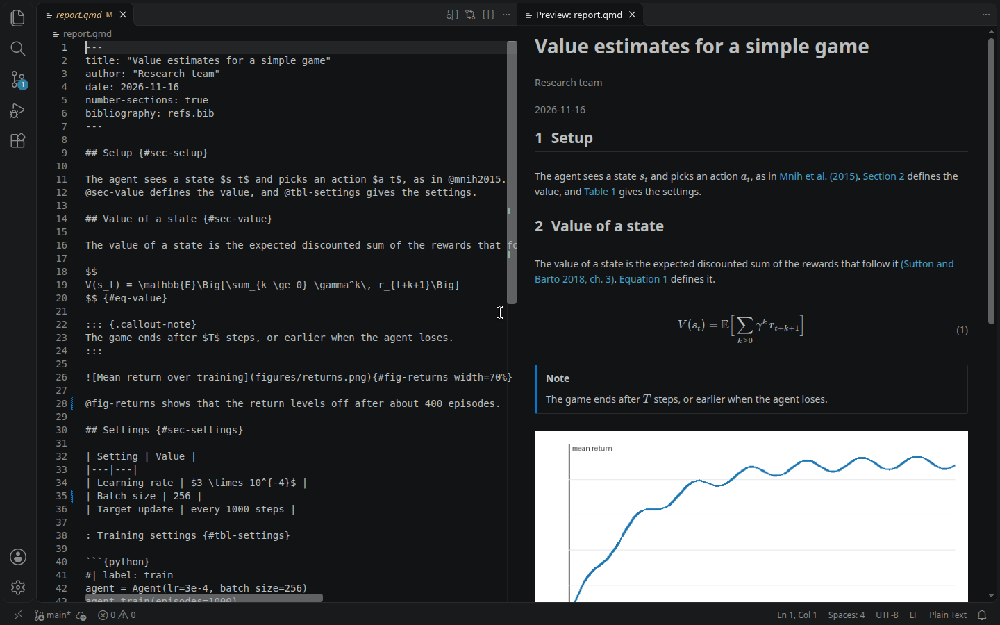

# Markdown Rendered Diff

Review changes to Markdown and Quarto files as rendered text, not only as source.

When you click a changed Markdown or Quarto file in the Source Control (Git) view, VS Code opens the source diff as usual. This extension opens a second tab next to it at the same time. The tab shows the old and the new version rendered side by side, with the changes marked. You do not have to run a command.


## Main features

- **Opens with the source diff.** Click a `.md` or `.qmd` file in the Source Control view, and the rendered diff opens next to the source diff. Click another Markdown or Quarto file, and the panel follows. The source diff keeps the focus.
- **Quarto.** `.qmd` files show section numbers, cross-references, citations, captions, callouts and code cells as Quarto renders them, without running Quarto. A new section that renumbers the others does not mark every reference as changed.
- **Quarto preview.** A `.qmd` editor gets the same preview button as a Markdown editor. It opens the rendered file next to the editor, with the Quarto features below.
- **Quarto build (experimental).** On request, a `.qmd` file is built with Quarto, and the preview and the diff show the values of its inline expressions and the tables and figures of its cells instead of placeholders. With both versions built, a number that changed is marked even where the text around it is the same.
- **Mermaid diagrams.** A ```` ```mermaid ```` block in Markdown, and a ```` ```{mermaid} ```` cell in Quarto, show the drawn diagram, in the colours of the light or dark theme. Each side of a diff draws its own version. Where the diagram's code changed, the code stays above the diagram with its changed lines marked.
- **Synced scrolling.** The rendered diff and the source diff editor scroll together. Scroll either one, and the other shows the same part of the file.
- **Formula diff.** In a changed formula, only the changed parts are marked, for example one subscript, one added term or a changed number. This works for inline formulas (`$…$`) and block formulas (`$$…$$`).
- **Word diff in paragraphs.** Changed words are marked red on the old side and green on the new side. Bold, italic, links and code stay formatted.
- **Aligned blocks.** Each paragraph, heading, list item, table and formula is on the same row as its counterpart. An added or removed block has an empty placeholder on the other side.
- **Fast on long documents.** While you edit, the panel updates only the rows that changed, and it lays out only the rows on screen.

### Paragraphs


### Formulas


When the two versions of a formula have too little in common, or the marked formula cannot render, the whole formula is marked. The `mdiff.formulaDiff` setting can mark the whole formula always.

### Tables and lists


- Tables are diffed row by row and cell by cell. An added or removed row has an empty placeholder row on the other side.
- Each item of a top-level list is its own row. A changed number in an ordered list does not count as a change.
- Code blocks are diffed line by line.
- YAML front matter (`title`, `subtitle`, `author`, `date`, `abstract`) shows as a title block and is diffed too. Other keys show in a small table.

### Quarto


`.qmd` files show the text that Quarto renders. Quarto is not run, and code cells are not executed. The example is `docs/demo/old.qmd` and `docs/demo/new.qmd`.

- **Sections:** heading attributes (`{#sec-x}`, `{.unnumbered}`) are hidden. With `number-sections: true` in the front matter, headings show Quarto's numbers.
- **Cross-references:** `@sec-x`, `@tbl-x`, `@fig-x` and `@eq-x` show as "Section 5.3", "Table 2" and so on. Each side shows its own numbers. A cross-reference is compared by its id, so a new section that renumbers the sections after it does not mark the references to them as changed. Section numbers are not compared either.
- **Table captions:** `: caption {#tbl-x}` shows as "Table N: caption" under the table.
- **Equations:** `$$ … $$ {#eq-x}` shows its number.
- **Citations:** `[@key, p. 3]`, `[see @a; @b]`, `@key` and `-@key` show in the author-date style, for example "(Gelada et al. 2019)". The author names and years come from the BibTeX files of `bibliography:` in the front matter. A key that is not in them shows as `?key`. A citation is compared by its keys, and a changed citation is marked as one unit.
- **Divs:** callouts (`::: {.callout-note}`) show as boxes. Other divs show their content, with a note on what a tabset, `.content-visible`/`.content-hidden` ("Only in html output"), a margin note or a wider column does. `::: {#refs}` shows a placeholder for the reference list.
- **Code cells and raw blocks:** ```` ```{python} ```` shows as code with a `python` label, and ```` ```{=latex} ```` as a dimmed block with a `raw latex` label. Both are diffed line by line. Cell options (`#| …`, also `# | …` as code formatters write them) and `execute:` count: code under `echo: false` or `include: false`, or folded with `code-fold`, is folded to one line saying so, and opens by itself when it changed.
- **Figures and tables of code cells:** `#| label: fig-x` with `fig-cap` shows "Figure N: caption" where the plot will be, numbered with the other figures, and `@fig-x` resolves. A cell with `output: asis` that prints a table counts as that table, by the `{#tbl-x}` it prints or the caption after it. Mermaid cells show the drawn diagram as the figure, and Graphviz cells their source. A plain ```` ```mermaid ```` block stays code, as in Quarto.
- **Inline expressions:** `` `{python} expr` `` shows as a small marked value with the expression in it and the full code on hover.
- **Project:** the nearest `_quarto.yml` above the file, the `_metadata.yml` files between and `_variables.yml` are read, so `execute:`, `number-sections` and `bibliography` there count.
- **Shortcodes:** `` shows the included file in place, `` and `` show their values, `` shows keys, and `` and `` say what they are. Others show as written.

### Quarto preview



VS Code has a preview for Markdown files but not for Quarto files. Click the preview button in the title bar of a `.qmd` editor, press `Ctrl+K V` (`Cmd+K V` on macOS), or right-click a `.qmd` file and choose "Open Quarto Preview to the Side". The preview shows what the diff shows for one side, in one column: everything in the list above, with the same limits. It updates while you type, scrolls with the editor, and follows the active `.qmd` editor. Front matter options such as `number-sections` are not shown.

### Quarto build (experimental)

Without a build, every inline expression shows as a code chip and every table or figure that a cell makes shows as a placeholder, and a report full of numbers is hard to read. A Quarto build fills them in. It runs the document's code, so it starts only when you click **Build with Quarto** in the bar at the top of the preview or the rendered diff (or run "Build with Quarto (Experimental)"), never by itself, and never in an untrusted workspace.

- **What it shows:** each inline expression shows its value as text of the sentence, with the expression on hover. Each cell shows its outputs under its figure or table number and caption: a table written as Markdown (`display(Markdown(...))`, `output: asis`), a plot, printed text, an HTML table, an error. `output: false`, `include: false` and `warning: false` are respected. The page is still rendered from the source, so the scroll sync keeps its lines. Values are matched to the source by their text in document order; a piece that the build has not shows "Not in the Quarto build of this version".
- **The preview** builds the saved file in its own folder, so its data files and imports are found. Quarto writes next to the file it renders, so the build renders a copy, `name.mdiff-1a2b3c4d.qmd`, in the same folder, which you see in the Explorer while it runs. The copy, the notebook Quarto keeps, a `.quarto` folder it made and its change to `.gitignore` are removed when the build ends; Quarto's output goes to a temporary folder. Unsaved changes are not in the build.
- **The rendered diff** builds both versions. The working-tree file is built as above. A Git version (`HEAD`, a commit, the index) is built in a temporary export of the repository at that version, with its own environment, so the old side runs the old code and data. The export is in the extension's storage on disk, not in the system's temporary folder, which can be in memory; it is deleted when its build ends. With both versions built, a value, a table cell or an output that changed is marked even where the source is the same. With one version built, its values show and nothing is marked for them.
- **The command:** `quarto render FILE --to gfm -M keep-ipynb:true -M freeze:false --no-execute-daemon --output-dir TEMP` (without `--output-dir` for an export), run in the file's folder, through `uv run` when a `uv.lock` is in the folder or above it (in the repository), so the build uses the project's environment; an export gets an environment of its own that way. The setting `mdiff.quarto.command` replaces the part before the file name, for example `conda run -n reports quarto render`. Quarto leaves a file out of its project when a folder of its path starts with a dot (the extension's storage under `~/.config`, a worktree under `.claude/`), so then it gets the file through a link to the repository in the system's temporary folder, removed after the build.
- **Results** are kept by version: by the file's text, and by the commit for a Git version. When the file changes after a build, the page keeps the values and says plainly that the file has changed since the build. Results are deleted 30 days after their build.
- **While it runs**, the bar and a notification show what it does and have a Cancel button. Cancel, the time limit of 30 minutes and closing the window stop Quarto and the Jupyter kernel it started, and remove the copy and the temporary folders. The full output of each build is in the "Markdown Rendered Diff: Quarto" output channel (the bar's **Log** button). A build that fails leaves the page as it was and says why.

## Install

Install "Markdown Rendered Diff" from the Extensions view, or run:

```bash
code --install-extension KonstantinSofeikov.mdiff
```

To build it from the source:

```bash
npm install
npm run package
code --install-extension mdiff.vsix
```

## Use

- **Source Control view:** click a changed `.md` or `.qmd` file. The rendered diff opens next to the source diff.
- **Diff editor title bar:** the "Show Rendered Diff" button opens the panel for the active diff.
- **Quarto editor title bar:** the preview button, or `Ctrl+K V`, opens the preview of the `.qmd` file next to it.
- **Explorer or editor tab context menu:** "Rendered Diff with HEAD" opens the source diff and the rendered diff of a file against `HEAD`.
- **Source Control context menu:** "Open Changes with Rendered Diff" works also when auto-open is off.

In the rendered diff:

| Key | Action |
|---|---|
| `n` or `j` | Next change |
| `p` or `k` | Previous change |
| `o` | Show only the changed blocks, or all blocks |

The panel updates when you edit the file.

## Settings

| Setting | Default | Description |
|---|---|---|
| `mdiff.autoOpen` | `true` | Open the rendered diff when a diff of a Markdown file opens. |
| `mdiff.scrollSync` | `true` | Scroll the rendered diff and the source diff editor together. |
| `mdiff.formulaDiff` | `parts` | `parts`: mark only the changed parts of a formula. `whole`: mark the whole formula. |
| `mdiff.quarto.command` | empty | Experimental. The command of a Quarto build up to the file name, for example `conda run -n reports quarto render`. Empty: `quarto render`, through `uv run` when the project has a `uv.lock`. Not read in an untrusted workspace. |

## Development

| Command | Action |
|---|---|
| `npm run build` | Bundle the extension and the CLI into `dist/`. |
| `npm test` | Run the unit tests of the diff core. |
| `npm run test:integration` | Start VS Code with the extension and test it against a temporary Git repository. The test window runs on a hidden display, so `xvfb-run` must be installed (`sudo apt install xvfb`). In a Wayland session, the window uses the X11 backend, so it also stays hidden there. Set `MDIFF_SHOW_WINDOW=1` to run it on your display instead. Set `VSCODE_BIN` to the VS Code (Electron) binary if it is not at `/snap/code/current/usr/share/code/code`. Set `MDIFF_QUARTO_BUILD=1` to also try the Quarto build for real on a small Python report (`test/fixtures/quarto-build/`, as a Quarto project in a folder under `.dot/`, where Quarto needs the link): a preview build, a cancel, a build of both versions and a failing build, with checks that no process or file is left. It needs Quarto and uv. |
| `npm run screenshots` | Take the README screenshots of `docs/demo/` in VS Code on a hidden display, and save them in `images/`. It needs `Xvfb`, `xwd`, `xdotool` and Python with Pillow. |
| `npm run bench -- [--before REF] [--runs N] OLD.md NEW.md ...` | Compare the speed of the diff core at a git ref (default `HEAD`) with the working tree. It shows the mean time difference and its 95% confidence interval for a first render (cold) and for a live update (warm): a new edit of the new file each time, with the same parser. |
| `node dist/cli.js OLD.md NEW.md OUT.html` | Write the rendered diff of two files to an HTML page. If either file is a `.qmd` file, the Quarto syntax is read. |

### Releases

Releases are published from GitHub Actions with Marketplace trusted publishing; no token is stored. Set the version in `package.json` and the changelog, commit to `master`, then push a tag `vX.Y.Z` with the same version. `.github/workflows/release.yml` checks that the tag is on `master` and matches `package.json`, runs `npm run typecheck`, `npm test` and `npm run package`, then waits for the maintainer's approval in the `marketplace` GitHub environment and runs `vsce publish --oidc`. The Marketplace policy accepts only that workflow file and environment name, so renaming either breaks publishing.

The diff core is in `src/core/` and does not use the VS Code API:

- `markdown.ts`: the parser (markdown-it with the KaTeX plugin of the built-in preview) and the front matter.
- `blocks.ts`: splits a document into blocks.
- `diff.ts`: aligns the blocks of the two versions and renders the rows.
- `inline.ts`: the word diff inside a block. Code spans and images are single units. A removed formula and an added formula at the same place pair, and `formula.ts` diffs them.
- `formula.ts`: the diff inside a formula. It parses the LaTeX into a small tree, aligns the two trees and wraps each changed part in `\htmlClass`.
- `align.ts`: the sequence alignment that the block, word and formula diffs use.
- `mermaid.ts`: which code blocks are Mermaid diagrams. The parser puts their source on the `<pre>`, and `src/webview/diagrams.ts` (bundled into `media/mermaid/` with the Mermaid library) draws them in the page. Mermaid runs in a hidden frame and loads only when a page has a diagram.
- `quarto.ts`: the Quarto syntax: section numbers, cross-references, captions, citations, divs, code cells with their options and figures, inline expressions, shortcodes and includes. Comparison keys render cross-references, citations and figures of cells by their source, so new numbers are not changes. With a Quarto build, it shows values and outputs; comparison keys hold them only when both versions were built.
- `quartoRun.ts`: reads a Quarto build from the notebook that Quarto keeps (`keep-ipynb`): the value of each inline expression (`user_expressions`) and the outputs of each cell, and hands them to the source in document order.

Outside the core, `project.ts` reads what a Quarto file takes from disk: `_quarto.yml`, `_metadata.yml`, `_variables.yml`, the bibliography (with `bibliography.ts`) and included files. `quartoBuild.ts` runs the Quarto build: the only code in the extension that runs the user's code.

## Limits

- Quarto build (experimental): only documents run by Quarto's Jupyter engine (Python, for one) can be built; knitr (R) keeps no notebook. An HTML output with scripts, such as a Plotly figure, is not drawn and keeps a placeholder. A piece that Quarto reads differently from the source (an expression written in another way) keeps its placeholder. The export of a Git version has only what Git has: data files that are not committed, submodules and Git LFS files are missing there, and its environment is made again each time (fast with uv's cache). A result is matched by the file's text, so a change of a data file alone does not make it older. If VS Code is killed during a build, the build runs to its end and the next window removes the copy it left; a normal close stops it. The kernel is found by a mark in its environment on Linux, and by the process tree elsewhere; cancelling was tested on Linux only.

- Quarto: code cells are not run unless you build the file (experimental), so their plots, tables and printed Markdown show as numbered places with their captions, and inline expressions show their code, not their values. Graphviz diagrams show their source. All content for every format is shown, with a note on what is conditional. An included file is rendered by itself, so its sections and figures are numbered apart from the document's. The project files are read from the working tree, also for the old side of a diff. Metadata from an extension's `_extension.yml` and `metadata-files:` is not read. Citations use one author-date style, not the CSL style of the document, and the reference list is not generated.

- Images with relative paths show from the working tree, also on the old side of a diff. Images outside the workspace folders and the folder of the first file shown do not show.
- Quarto figures (`{#fig-x}`) show the image, but not the "Figure N: caption" line or the `width` attribute.
- Graphviz diagrams are not drawn, nor are Mermaid mindmaps and architecture diagrams (the extension ships the smaller Mermaid build without them); these show as code with a note. Code blocks are not syntax-highlighted.
- A rewritten paragraph that has few words in common with the old one shows as a whole-block change.

## Changelog

### 0.9.0
- Quarto build (experimental): a **Build with Quarto** button on the preview and the rendered diff of a `.qmd` file runs the document with Quarto and shows the values of its inline expressions and the tables, plots and printed output of its cells instead of placeholders. The diff builds both versions, the old one in a temporary export of the repository with its own environment, and marks a value or a table cell that changed even where the source is the same. Builds start only from a click, not in an untrusted workspace, can be cancelled, stop after 30 minutes, and log to an output channel. New setting `mdiff.quarto.command`.

### 0.8.0
- Mermaid diagrams are drawn: ```` ```mermaid ```` blocks in Markdown and ```` ```{mermaid} ```` cells in Quarto, in the diff and in the Quarto preview. The diagram takes the place of its code, except where the code changed: then the code with its marked lines stays, and each side draws its own version below it. Diagrams follow the light or dark colour theme. A diagram that Mermaid can't read stays code, with the first line of the error.

### 0.7.0
- Quarto code cells as the rendered document has them: cell options and `execute:` are read, and code under `echo: false`, `include: false` or `code-fold` is folded to one line; a cell whose code changed opens by itself.
- Figures and tables made by code cells (`#| label: fig-…` with `fig-cap`, `output: asis` cells that print a table) are numbered with their captions, so `@fig-…` and `@tbl-…` that pointed to them resolve. Mermaid and Graphviz cells show their source as the figure.
- Inline expressions (`` `{python} expr` ``) show as a small marked value instead of code in the middle of a sentence.
- The project's `_quarto.yml`, `_metadata.yml` and `_variables.yml` are read. `` shows the included file, `` and `` their values, and ``, `` and `` what they are.
- Tabsets, conditional content, margin notes and wider columns say what they do.
- A click on `@eq-…`, or on `@fig-…` of an image figure, scrolls to it.

### 0.6.0
- Quarto preview: a preview button in the title bar of `.qmd` editors, `Ctrl+K V`, and "Open Quarto Preview to the Side" in the context menus. It renders the file in one column with the Quarto support of the diff, updates while you type and scrolls with the editor.
- Images with relative paths show, in the preview and in the diff.
- A front matter `date` shows as written, for example `2026-11-16`, not as a full timestamp.

### 0.5.1
- A block whose text changed only in white space, for example a re-wrapped paragraph or a double space, is not a change. Before, it counted as a change with nothing marked. A change of indentation in a code block is still a change.

### 0.5.0
- Quarto (`.qmd`) files: section numbers, cross-references, table captions, equation numbers, citations from the BibTeX bibliography, callouts, code cells, raw blocks and shortcodes. A new section that renumbers the sections after it does not mark the references to them as changed.
- An author in the front matter that is an object with a `name`, as Quarto writes it, shows its name.
- Faster live updates of long documents. On a 700-line Quarto document, one edit took about 160 ms in the panel and now takes 5 to 25 ms:
  - Rows off screen are not laid out (`content-visibility`).
  - The extension sends only the changed rows, 11 KB instead of 1.4 MB, and the panel keeps the other rows.
  - The side that did not change is not parsed again: the diff takes 12 ms, not 18 ms.
- The integration test and the screenshot script keep their VS Code window on the hidden display in a Wayland session.

### 0.4.3
- A changelog in the README.

### 0.4.2
- Rendering is 1.75x to 4.9x faster on large documents. On a 611-line document with 331 formulas, a first render takes 94 ms, not 164 ms, and a live update 67 ms, not 160 ms. Each formula is now rendered once and kept.
- `npm run bench` compares the speed of two versions, with a 95% confidence interval.

### 0.4.1
- The package is 418 KB, not 1.06 MB: only the `woff2` KaTeX fonts are included, and the bundle is minified.

### 0.4.0
- Screenshots in the README.
- Fix: at the top of the file, the synced scroll showed the subtitle at the top, not the title.
- A decimal number, such as `0.99`, is one word in the word diff.

### 0.3.3
- Repository, homepage and issue links to GitHub.

### 0.3.2
- MIT license.

### 0.3.1
- Publisher `KonstantinSofeikov`. The extension ID is `KonstantinSofeikov.mdiff`.
- One KaTeX copy in the bundle, not two: 1.44 MB to 1.0 MB.
- Updated packages with security advisories: `js-yaml` 4.3.2, KaTeX 0.19.0, `@vscode/vsce` 4.0.0. `npm audit` finds 0 vulnerabilities.

### 0.3.0
- Synced scrolling between the source diff editor and the rendered diff, in both directions. Setting: `mdiff.scrollSync`.

### 0.2.0
- Formula diff: only the changed parts of a formula are marked. Setting: `mdiff.formulaDiff`.

### 0.1.0
- First version. The rendered diff opens next to the source diff when you click a Markdown file in the Source Control view.
- Block alignment, word diff, table cell diff, list items as rows, line diff for code, and front matter.
- A changed formula is marked as a whole.

## License

MIT. See [LICENSE](LICENSE).
