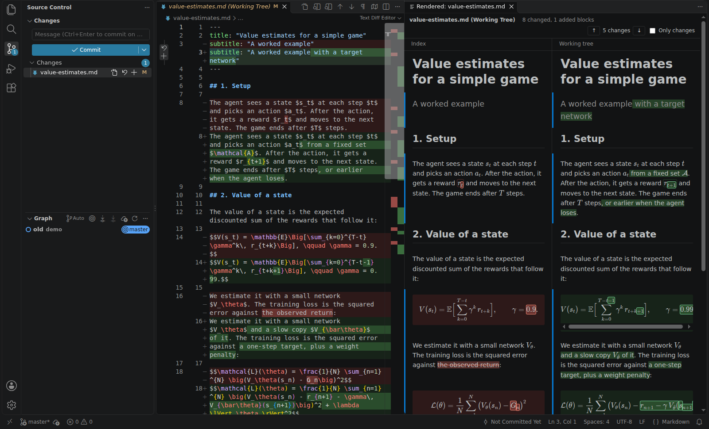
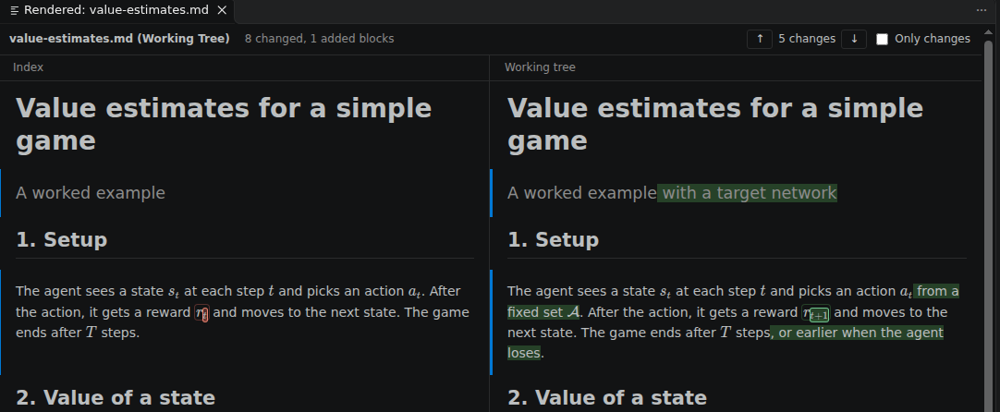
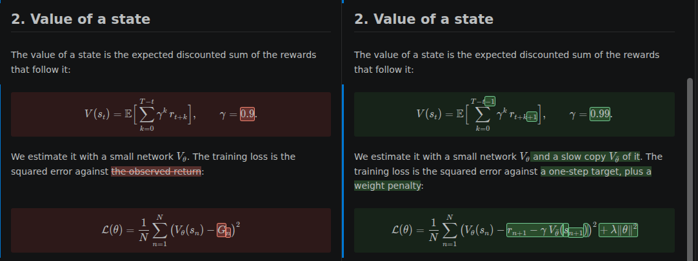
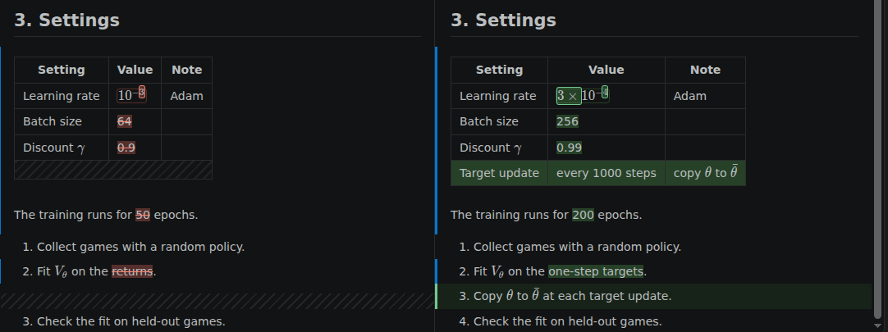
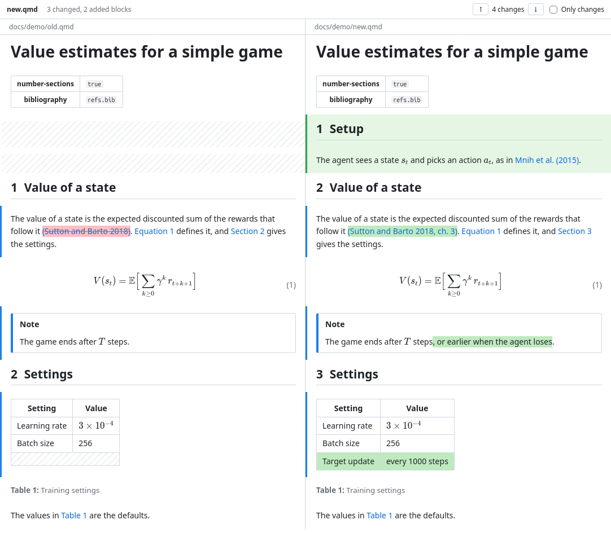

# Markdown Rendered Diff

Review changes to Markdown and Quarto files as rendered text, not only as source.

When you click a changed Markdown or Quarto file in the Source Control (Git) view, VS Code opens the source diff as usual. This extension opens a second tab next to it at the same time. The tab shows the old and the new version rendered side by side, with the changes marked. You do not have to run a command.



## Main features

- **Opens with the source diff.** Click a `.md` or `.qmd` file in the Source Control view, and the rendered diff opens next to the source diff. Click another Markdown or Quarto file, and the panel follows. The source diff keeps the focus.
- **Quarto.** `.qmd` files show section numbers, cross-references, citations, captions, callouts and code cells as Quarto renders them, without running Quarto. A new section that renumbers the others does not mark every reference as changed.
- **Synced scrolling.** The rendered diff and the source diff editor scroll together. Scroll either one, and the other shows the same part of the file.
- **Formula diff.** In a changed formula, only the changed parts are marked, for example one subscript, one added term or a changed number. This works for inline formulas (`$…$`) and block formulas (`$$…$$`).
- **Word diff in paragraphs.** Changed words are marked red on the old side and green on the new side. Bold, italic, links and code stay formatted.
- **Aligned blocks.** Each paragraph, heading, list item, table and formula is on the same row as its counterpart. An added or removed block has an empty placeholder on the other side.
- **Fast on long documents.** While you edit, the panel updates only the rows that changed, and it lays out only the rows on screen.

### Paragraphs



### Formulas



When the two versions of a formula have too little in common, or the marked formula cannot render, the whole formula is marked. The `mdiff.formulaDiff` setting can mark the whole formula always.

### Tables and lists



- Tables are diffed row by row and cell by cell. An added or removed row has an empty placeholder row on the other side.
- Each item of a top-level list is its own row. A changed number in an ordered list does not count as a change.
- Code blocks are diffed line by line.
- YAML front matter (`title`, `subtitle`, `author`, `date`, `abstract`) shows as a title block and is diffed too. Other keys show in a small table.

### Quarto



`.qmd` files show the text that Quarto renders. Quarto is not run, and code cells are not executed. The example is `docs/demo/old.qmd` and `docs/demo/new.qmd`.

- **Sections:** heading attributes (`{#sec-x}`, `{.unnumbered}`) are hidden. With `number-sections: true` in the front matter, headings show Quarto's numbers.
- **Cross-references:** `@sec-x`, `@tbl-x`, `@fig-x` and `@eq-x` show as "Section 5.3", "Table 2" and so on. Each side shows its own numbers. A cross-reference is compared by its id, so a new section that renumbers the sections after it does not mark the references to them as changed. Section numbers are not compared either.
- **Table captions:** `: caption {#tbl-x}` shows as "Table N: caption" under the table.
- **Equations:** `$$ … $$ {#eq-x}` shows its number.
- **Citations:** `[@key, p. 3]`, `[see @a; @b]`, `@key` and `-@key` show in the author-date style, for example "(Gelada et al. 2019)". The author names and years come from the BibTeX files of `bibliography:` in the front matter. A key that is not in them shows as `?key`. A citation is compared by its keys, and a changed citation is marked as one unit.
- **Divs:** callouts (`::: {.callout-note}`) show as boxes. Other divs, such as tabsets, show their content. `::: {#refs}` shows a placeholder for the reference list.
- **Code cells and raw blocks:** ```` ```{python} ```` shows as code with a `python` label, and ```` ```{=latex} ```` as a dimmed block with a `raw latex` label. Both are diffed line by line.
- **Shortcodes:** `` show as written.

## Install

Install "Markdown Rendered Diff" from the Extensions view, or run:

```bash
code --install-extension KonstantinSofeikov.mdiff
```

To build it from the source:

```bash
npm install
npm run package
code --install-extension mdiff.vsix
```

## Use

- **Source Control view:** click a changed `.md` or `.qmd` file. The rendered diff opens next to the source diff.
- **Diff editor title bar:** the "Show Rendered Diff" button opens the panel for the active diff.
- **Explorer or editor tab context menu:** "Rendered Diff with HEAD" opens the source diff and the rendered diff of a file against `HEAD`.
- **Source Control context menu:** "Open Changes with Rendered Diff" works also when auto-open is off.

In the rendered diff:

| Key | Action |
|---|---|
| `n` or `j` | Next change |
| `p` or `k` | Previous change |
| `o` | Show only the changed blocks, or all blocks |

The panel updates when you edit the file.

## Settings

| Setting | Default | Description |
|---|---|---|
| `mdiff.autoOpen` | `true` | Open the rendered diff when a diff of a Markdown file opens. |
| `mdiff.scrollSync` | `true` | Scroll the rendered diff and the source diff editor together. |
| `mdiff.formulaDiff` | `parts` | `parts`: mark only the changed parts of a formula. `whole`: mark the whole formula. |

## Development

| Command | Action |
|---|---|
| `npm run build` | Bundle the extension and the CLI into `dist/`. |
| `npm test` | Run the unit tests of the diff core. |
| `npm run test:integration` | Start VS Code with the extension and test it against a temporary Git repository. The test window runs on a hidden display, so `xvfb-run` must be installed (`sudo apt install xvfb`). In a Wayland session, the window uses the X11 backend, so it also stays hidden there. Set `MDIFF_SHOW_WINDOW=1` to run it on your display instead. Set `VSCODE_BIN` to the VS Code (Electron) binary if it is not at `/snap/code/current/usr/share/code/code`. |
| `npm run screenshots` | Take the README screenshots of `docs/demo/` in VS Code on a hidden display, and save them in `images/`. It needs `Xvfb`, `xwd`, `xdotool` and Python with Pillow. |
| `npm run bench -- [--before REF] [--runs N] OLD.md NEW.md ...` | Compare the speed of the diff core at a git ref (default `HEAD`) with the working tree. It shows the mean time difference and its 95% confidence interval for a first render (cold) and for a live update (warm): a new edit of the new file each time, with the same parser. |
| `node dist/cli.js OLD.md NEW.md OUT.html` | Write the rendered diff of two files to an HTML page. If either file is a `.qmd` file, the Quarto syntax is read. |

The diff core is in `src/core/` and does not use the VS Code API:

- `markdown.ts`: the parser (markdown-it with the KaTeX plugin of the built-in preview) and the front matter.
- `blocks.ts`: splits a document into blocks.
- `diff.ts`: aligns the blocks of the two versions and renders the rows.
- `inline.ts`: the word diff inside a block. Code spans and images are single units. A removed formula and an added formula at the same place pair, and `formula.ts` diffs them.
- `formula.ts`: the diff inside a formula. It parses the LaTeX into a small tree, aligns the two trees and wraps each changed part in `\htmlClass`.
- `align.ts`: the sequence alignment that the block, word and formula diffs use.
- `quarto.ts`: the Quarto syntax: section numbers, cross-references, captions, citations, divs and code cells. Comparison keys render cross-references and citations by their source, so new numbers are not changes.

## Limits

- Quarto: the output of code cells, ``, Mermaid and Graphviz diagrams, and conditional content (`.content-visible`) are not rendered. `number-sections` and `bibliography` in `_quarto.yml` are not read, only those in the front matter of the file. Citations use one author-date style, not the CSL style of the document, and the reference list is not generated.

- Images with relative paths do not show.
- Mermaid diagrams and syntax highlighting of code blocks are not supported.
- A rewritten paragraph that has few words in common with the old one shows as a whole-block change.

## Changelog

### 0.5.1
- A block whose text changed only in white space, for example a re-wrapped paragraph or a double space, is not a change. Before, it counted as a change with nothing marked. A change of indentation in a code block is still a change.

### 0.5.0
- Quarto (`.qmd`) files: section numbers, cross-references, table captions, equation numbers, citations from the BibTeX bibliography, callouts, code cells, raw blocks and shortcodes. A new section that renumbers the sections after it does not mark the references to them as changed.
- An author in the front matter that is an object with a `name`, as Quarto writes it, shows its name.
- Faster live updates of long documents. On a 700-line Quarto document, one edit took about 160 ms in the panel and now takes 5 to 25 ms:
  - Rows off screen are not laid out (`content-visibility`).
  - The extension sends only the changed rows, 11 KB instead of 1.4 MB, and the panel keeps the other rows.
  - The side that did not change is not parsed again: the diff takes 12 ms, not 18 ms.
- The integration test and the screenshot script keep their VS Code window on the hidden display in a Wayland session.

### 0.4.3
- A changelog in the README.

### 0.4.2
- Rendering is 1.75x to 4.9x faster on large documents. On a 611-line document with 331 formulas, a first render takes 94 ms, not 164 ms, and a live update 67 ms, not 160 ms. Each formula is now rendered once and kept.
- `npm run bench` compares the speed of two versions, with a 95% confidence interval.

### 0.4.1
- The package is 418 KB, not 1.06 MB: only the `woff2` KaTeX fonts are included, and the bundle is minified.

### 0.4.0
- Screenshots in the README.
- Fix: at the top of the file, the synced scroll showed the subtitle at the top, not the title.
- A decimal number, such as `0.99`, is one word in the word diff.

### 0.3.3
- Repository, homepage and issue links to GitHub.

### 0.3.2
- MIT license.

### 0.3.1
- Publisher `KonstantinSofeikov`. The extension ID is `KonstantinSofeikov.mdiff`.
- One KaTeX copy in the bundle, not two: 1.44 MB to 1.0 MB.
- Updated packages with security advisories: `js-yaml` 4.3.2, KaTeX 0.19.0, `@vscode/vsce` 4.0.0. `npm audit` finds 0 vulnerabilities.

### 0.3.0
- Synced scrolling between the source diff editor and the rendered diff, in both directions. Setting: `mdiff.scrollSync`.

### 0.2.0
- Formula diff: only the changed parts of a formula are marked. Setting: `mdiff.formulaDiff`.

### 0.1.0
- First version. The rendered diff opens next to the source diff when you click a Markdown file in the Source Control view.
- Block alignment, word diff, table cell diff, list items as rows, line diff for code, and front matter.
- A changed formula is marked as a whole.

## License

MIT. See [LICENSE](LICENSE).
